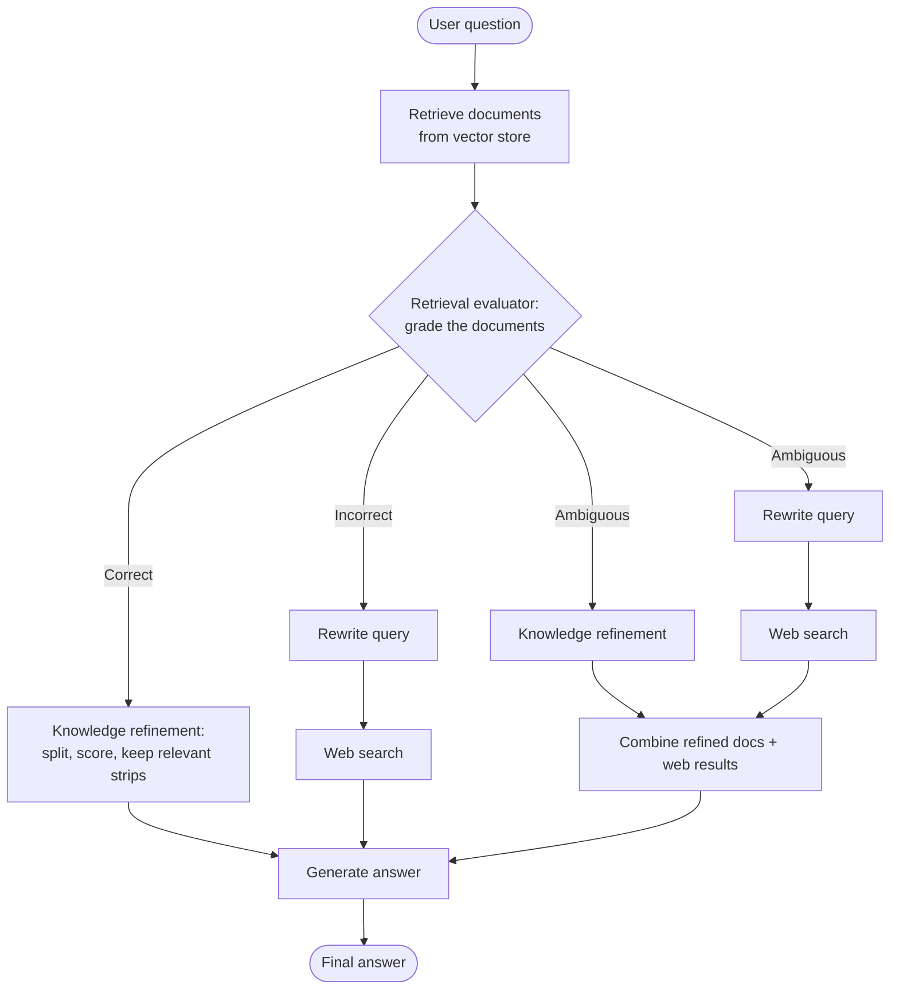
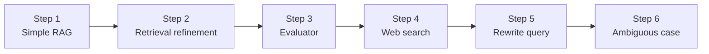

<div align="center">

#  Corrective RAG (CRAG) with LangGraph

**A step-by-step implementation of Corrective Retrieval-Augmented Generation: evaluate what was retrieved, refine it, and fall back to web search when retrieval goes wrong.**


</div>

---

##  About

This repository is a **basic-understanding implementation of Corrective RAG using LangGraph**. It is built as a series of numbered notebooks that start from a plain RAG pipeline and add one corrective capability at a time: refinement, evaluation, web search, query rewriting and handling of ambiguous cases.

Standard RAG retrieves documents and passes them straight to the LLM, even when the retrieved context is irrelevant. Corrective RAG adds a feedback loop: it **evaluates** what was retrieved, **refines** the good parts, and **falls back to web search** when the knowledge base can't answer the question.


## Why Corrective RAG?

Basic RAG has a blind spot: **it trusts whatever the retriever returns.** That causes problems when:

- the knowledge base has no relevant document, so the LLM answers from noise or hallucinates
- retrieved chunks are only partly relevant and the useful part is buried
- the user's query is vague, so retrieval misses the right content
- the question needs fresh information the documents don't contain

Corrective RAG addresses these by grading retrieval quality and choosing a different path depending on the result.

This repo walks through that idea in six small notebooks, each adding one capability on top of the last.


---

##  Research Paper

This project is based on the CRAG paper:

> **Corrective Retrieval Augmented Generation**
> Shi-Qi Yan, Jia-Chen Gu, Yun Zhu, Zhen-Hua Ling
> arXiv:2401.15884 [cs.CL], January 2024

| Resource | Link |
| --- | --- |
|  Paper (abstract) | [arxiv.org/abs/2401.15884](https://arxiv.org/abs/2401.15884) |
|  Paper (PDF) | [arxiv.org/pdf/2401.15884](https://arxiv.org/pdf/2401.15884) |
|  Authors' code | [HuskyInSalt/CRAG](https://github.com/HuskyInSalt/CRAG) |

**The paper's idea in short:** RAG depends heavily on how relevant the retrieved documents are, so what happens when retrieval goes wrong? CRAG adds a **lightweight retrieval evaluator** that scores the quality of retrieved documents for a query and returns a confidence level. That confidence decides which knowledge retrieval action to trigger. The paper also describes CRAG as plug-and-play, meaning it can be combined with other RAG approaches, and reports gains on four datasets covering short- and long-form generation.

---

##  The Problem CRAG Solves

| Standard RAG | Corrective RAG |
| --- | --- |
| Uses whatever the retriever returns | **Evaluates** the retrieved documents first |
| Irrelevant or outdated documents flow straight into the answer | Poor retrievals are **corrected or replaced** |
| Entire documents are passed to the LLM, including noise | Documents are **refined** so only the useful parts are kept |
| Limited to the knowledge in the vector store | Can reach out to the **web** when the store falls short |

---

## Tech Stack Used

| Layer | Technology |
|---|---|
| Language | Python |
| Orchestration | LangGraph, LangChain |
| LLM | <!-- VERIFY: e.g. Groq / OpenAI --> |
| Embeddings | <!-- VERIFY: e.g. HuggingFace / OpenAI --> |
| Vector store | <!-- VERIFY: e.g. FAISS / Chroma --> |
| Web search | <!-- VERIFY: e.g. Tavily --> |
| Environment | Jupyter Notebook |

---
##  How CRAG Works

The retrieval evaluator assigns a confidence level, and each level triggers a different action:

| Verdict | Meaning | Action |
| --- | --- | --- |
|  **Correct** | At least one retrieved document is highly relevant | **Refine** the retrieved documents, keeping only the relevant knowledge |
|  **Incorrect** | All retrieved documents are irrelevant | **Discard** them and rewrite the query for a **web search** |
|  **Ambiguous** | The evaluator is not confident either way | **Combine** the refined retrieved knowledge with web search results |

**Knowledge refinement (decompose, filter, recompose):** the retrieved documents are split into small knowledge strips, each strip is scored for relevance, irrelevant strips are dropped, and the remaining ones are put back together as clean context.

---

##  Architecture



>  This diagram shows the general CRAG flow from the paper. Adjust it to match the exact nodes and routing in your notebooks.

---

##  How This Implementation Relates to the Paper

The paper's evaluator is a **fine-tuned lightweight model** (a T5-based retrieval evaluator). This repository implements the same decision logic as a **LangGraph workflow**, where each step is a node and routing happens through conditional edges. The goal is to understand the corrective flow rather than to reproduce the paper's trained evaluator or its benchmark results.

| Paper concept | Notebook |
| --- | --- |
| Standard RAG baseline | `step1_simple_RAG.ipynb` |
| Knowledge refinement | `step2_retrieval_refinement.ipynb` |
| Retrieval evaluator (Correct / Incorrect / Ambiguous) | `step3__evaluator_rag3.ipynb` |
| Web search as a corrective action | `step4_websearch_refinement_rag.ipynb` |
| Query rewriting for web search | `step5_rewrite_query.ipynb` |
| Ambiguous case: combine both knowledge sources | `step6_ambiguous_RAG.ipynb` |

---

##  Notebook 



| Step | Notebook | What it adds |
| :-: | --- | --- |
| 1 | [`step1_simple_RAG.ipynb`](./step1_simple_RAG.ipynb) | **Baseline:** a simple retrieve-and-generate pipeline |
| 2 | [`step2_retrieval_refinement.ipynb`](./step2_retrieval_refinement.ipynb) | **Retrieval refinement:** filter retrieved content down to what is relevant |
| 3 | [`step3__evaluator_rag3.ipynb`](./step3__evaluator_rag3.ipynb) | **Evaluator:** grade retrieval quality and route on the result |
| 4 | [`step4_websearch_refinement_rag.ipynb`](./step4_websearch_refinement_rag.ipynb) | **Web search:** fall back to the web when retrieval is poor |
| 5 | [`step5_rewrite_query.ipynb`](./step5_rewrite_query.ipynb) | **Query rewriting:** turn the question into a better search query |
| 6 | [`step6_ambiguous_RAG.ipynb`](./step6_ambiguous_RAG.ipynb) | **Ambiguous case:** combine refined documents with web results |

The [`documents/`](./documents) folder holds the source documents used for the vector store.

>  The "What it adds" column follows the notebook names and the paper. Adjust each line to what your notebook really does (for example the evaluator model, the web search tool and the thresholds you used).

---

### Prerequisites

- Python 3.10+
- Jupyter Notebook / JupyterLab (or VS Code with the Jupyter extension)
- An API key for your LLM provider
- A web search API key (for the web search steps, for example Tavily)

### Installation

**1. Clone the repository**

```bash
git clone https://github.com/SyedaNaziaGit/Corrective_RAG.git
cd Corrective_RAG
```

**2. Create and activate a virtual environment**

```bash
python -m venv venv

# Windows (PowerShell)
venv\Scripts\Activate.ps1

# macOS / Linux
source venv/bin/activate
```

**3. Install the dependencies**

```bash
pip install langgraph langchain langchain-openai langchain-community faiss-cpu python-dotenv
```

If you use plain Jupyter rather than VS Code:

```bash
pip install jupyter
```

**4. Set up environment variables**

Create a `.env` file in the project root:

```
OPENAI_API_KEY=your_llm_api_key_here
TAVILY_API_KEY=your_web_search_api_key_here
```

>  Never commit your `.env` file or API keys. Add `.env` to `.gitignore`.

**5. Run the notebooks in order**

Open `step1_simple_RAG.ipynb`, select the `venv` kernel, and work through to `step6_ambiguous_RAG.ipynb`.

>  Edit the install line and `.env` keys to match what your notebooks import and which LLM and search tool you use.

---

##  Troubleshooting

| Problem | Fix |
| --- | --- |
| `ModuleNotFoundError` | Activate the virtual environment and re-run the `pip install` command |
| Authentication or missing API key error | Check `.env` is in the project root, then restart the notebook kernel |
| Web search step returns nothing | Confirm the search API key is set and has quota remaining |
| Evaluator always says "Correct" or always "Incorrect" | Review the grading prompt and the relevance threshold |
| Answers ignore the web results | Check that the graph routes the Incorrect and Ambiguous paths to the web search node |
| Wrong Python in the notebook | In VS Code, choose the `venv` kernel from the kernel picker |

---

##  Key Takeaways

- Standard RAG trusts the retriever. CRAG **assumes retrieval can go wrong** and checks it.
- A **retrieval evaluator** turns "was this good enough?" into an explicit routing decision.
- **Refinement** removes noise from documents before generation.
- **Web search** with a rewritten query gives a safety net when the vector store has nothing useful.
- The **ambiguous** path hedges by using both knowledge sources.

---

##  Part of My RAG Series

| Repository | Focus |
| --- | --- |
| [AgenticRAG](https://github.com/SyedaNaziaGit/AgenticRAG) | From fixed retrieval to autonomous, graph-based agents |
| [Self_RAG](https://github.com/SyedaNaziaGit/Self_RAG) | Self-reflection on retrieval, grounding and usefulness |
| **Corrective_RAG** (this repo) | Evaluating and correcting retrieval, with web search fallback |

---

##  References

1. S.-Q. Yan, J.-C. Gu, Y. Zhu, Z.-H. Ling. *Corrective Retrieval Augmented Generation.* arXiv:2401.15884, 2024. [Link](https://arxiv.org/abs/2401.15884)
2. [Authors' code: HuskyInSalt/CRAG](https://github.com/HuskyInSalt/CRAG)
3. [LangGraph documentation](https://langchain-ai.github.io/langgraph/)

**Cite the paper:**

```bibtex
@article{yan2024corrective,
  title   = {Corrective Retrieval Augmented Generation},
  author  = {Yan, Shi-Qi and Gu, Jia-Chen and Zhu, Yun and Ling, Zhen-Hua},
  journal = {arXiv preprint arXiv:2401.15884},
  year    = {2024}
}
```
---


